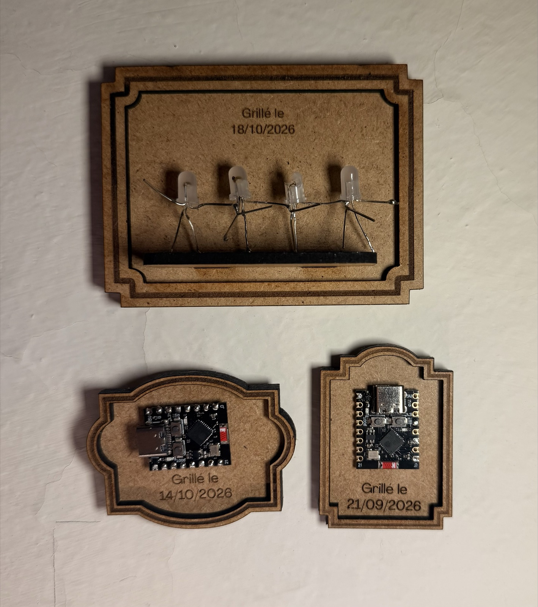
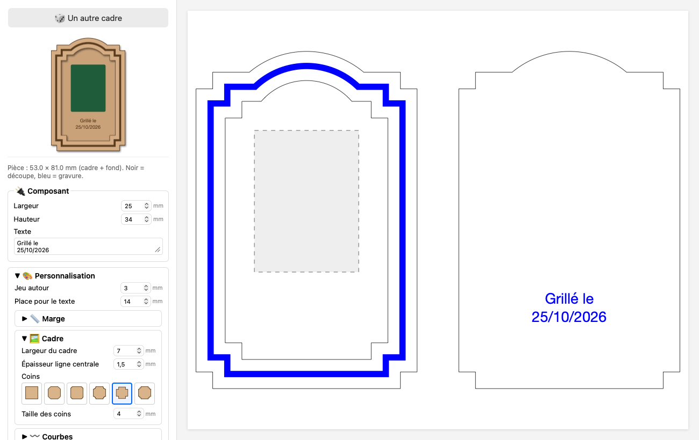
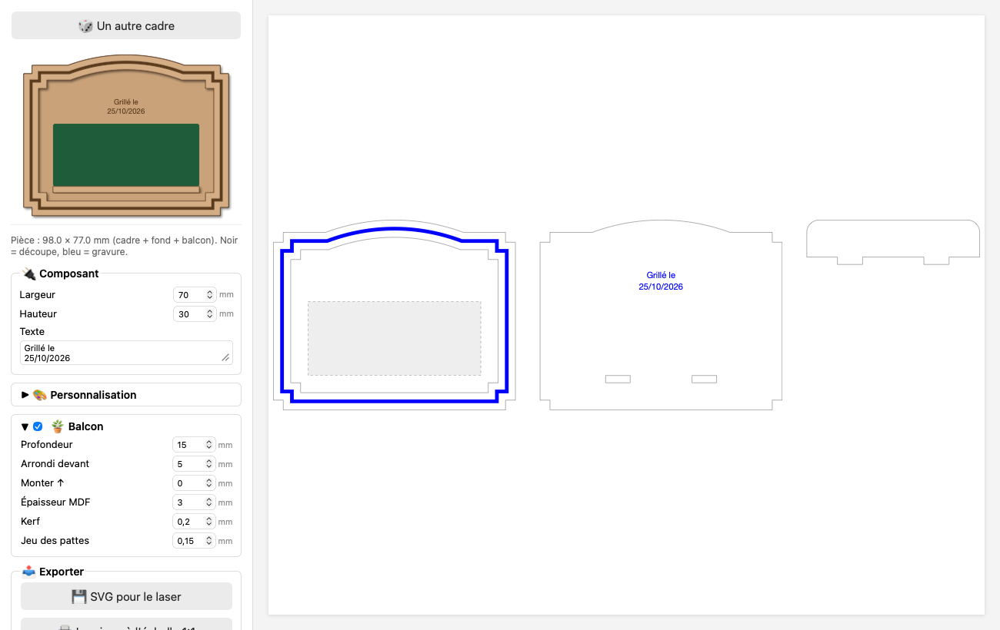
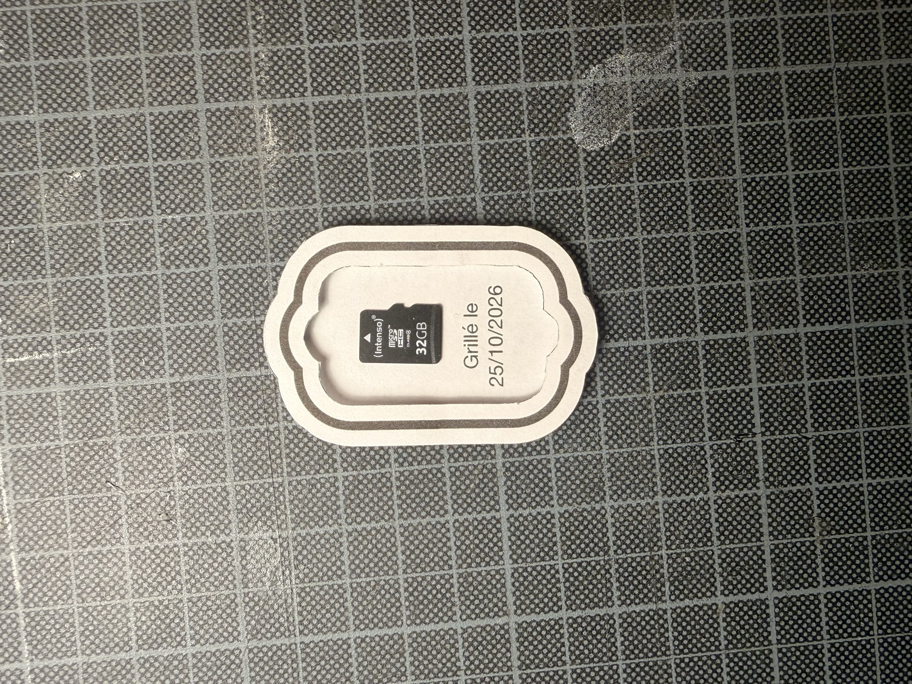

# Cimetière des ESP

À force de bricoler, on finit forcément par griller des composants. Ce sont un peu les héros sacrifiés de nos créations.
Plutôt que de les oublier au fond d'un bac de recyclage, je les encadre. Pour ne pas les oublier, et parce que sans leur
sacrifice, nos projets ne seraient sans doute pas debout aujourd'hui.

Cette page web dessine des cadres avec une forme un peu différente à chaque fois.
Il suffit d'écrire la taille du composant et la date : c'est prêt à graver ou imprimer.
Pas de graveuse laser ? Une imprimante et un cutter suffisent (voir [Version papier](#version-papier)).

**▶ Utiliser l'app : https://meutedechien.github.io/cimetiere-des-esp/**

## Ce que ça fait

- **Deux pièces** : le cadre (contour, fenêtre, ligne épaisse gravée au milieu du tour) et le fond (même contour, texte gravé).
- **🎲 Un autre cadre** : tire au hasard les coins (droits, chanfrein, arrondis, creux, cran, double cran) et les courbes (bosse ou creux en haut, en bas, sur les côtés).
- **Texte** : « Grillé le » + la date du jour, modifiable. Sous le composant ou au-dessus, et déplaçable à la souris (il se recentre tout seul près du milieu).
- **Espacement manuel** : la place libre en haut, en bas et sur les côtés, au millimètre.
- **Balcon** : une petite étagère de la largeur du composant, pour les objets qui tiennent debout. Ses pattes s'emboîtent dans le fond (une seule patte jusqu'à 50 mm, deux au-delà).
- **Aperçu MDF** : les pièces superposées, en couleur bois.
- **Export SVG** en millimètres : noir = découpe, bleu = gravure.
- **Version imprimable** : impression à l'échelle 1:1, anneau en noir. Pas besoin de laser, un cutter suffit.

## Version papier

Pas de laser ? Le bouton **🖨️ Imprimer à l'échelle 1:1** imprime le cadre à la vraie taille, avec l'anneau gravé en noir.
On découpe la fenêtre au cutter, on glisse le composant derrière, et c'est fini.
Dans la fenêtre d'impression, choisis « Taille réelle » (ou 100 %), sinon le cadre est réduit.

## Réglages d'emboîtement

Dans le menu **Balcon** :

- **Kerf** (0,2 mm par défaut) : la largeur du trait du laser. Les pattes sont dessinées plus larges et les fentes plus étroites d'autant.
- **Jeu des pattes** (0,15 mm par défaut) : agrandit seulement les fentes. Ça force ? Monte-le. Ça flotte ? Baisse-le.
- **Épaisseur MDF** : mesure la vraie au pied à coulisse. Le « 3 mm » fait souvent entre 2,9 et 3,2 mm.

## Technique

Une seule page HTML, sans installation ni serveur. Les contours décalés sont calculés avec
[Clipper](https://sourceforge.net/projects/jsclipper/) d'Angus Johnson (version JavaScript de Timo) (`clipper.js`, licence Boost 1.0).

Le texte reste du texte dans le SVG : si la police n'est pas installée là où tu ouvres le fichier, vectorise-le avant de graver.

Licence MIT.
